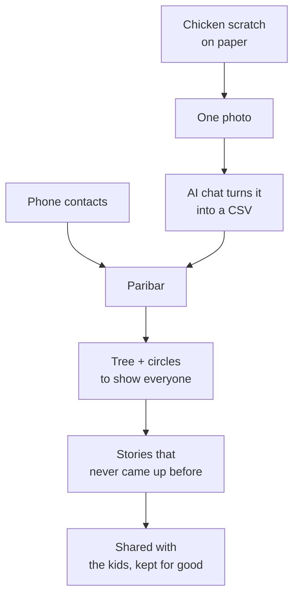
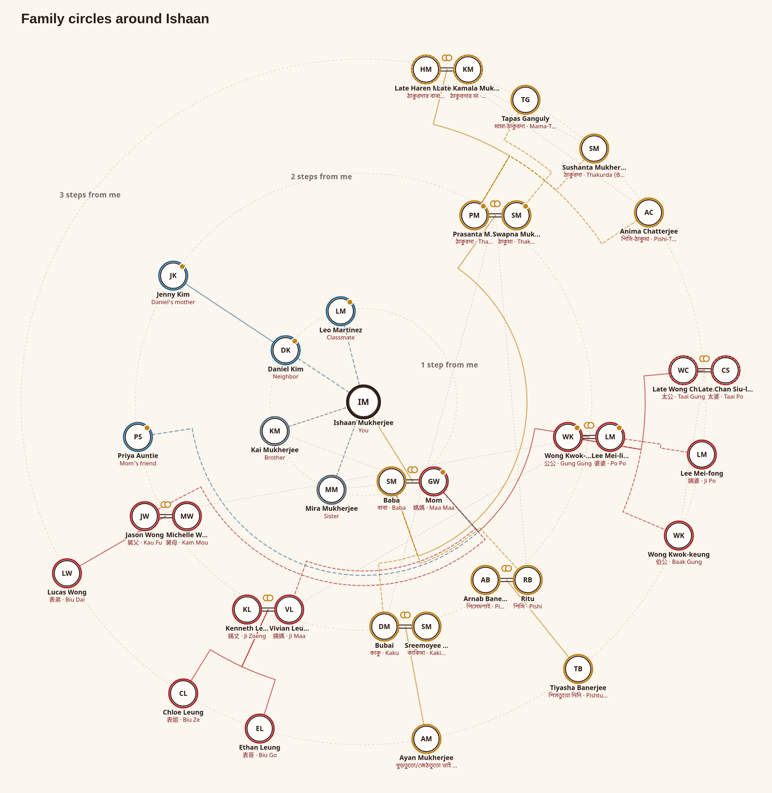
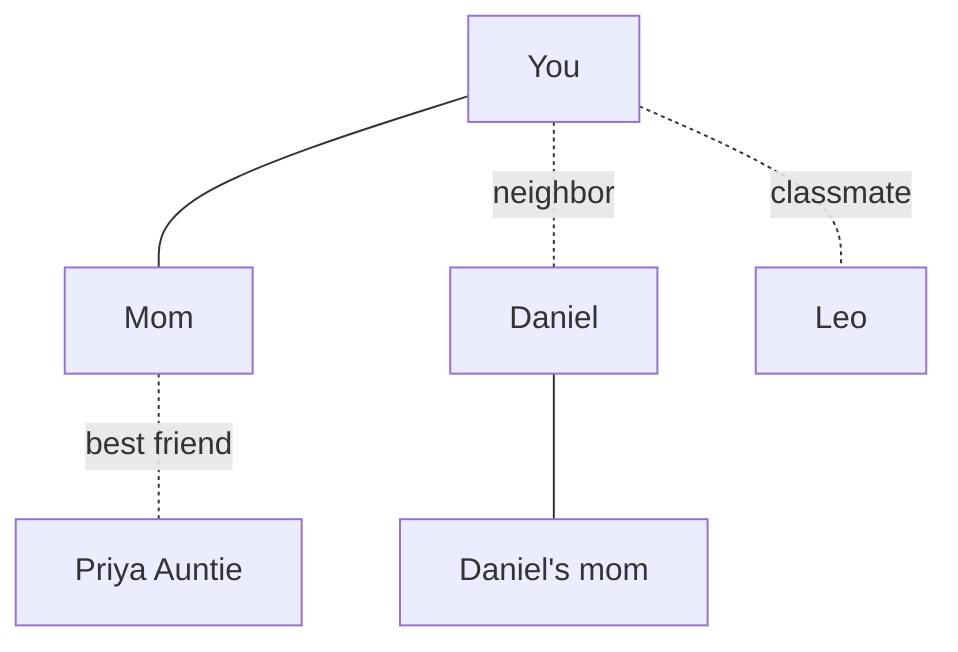
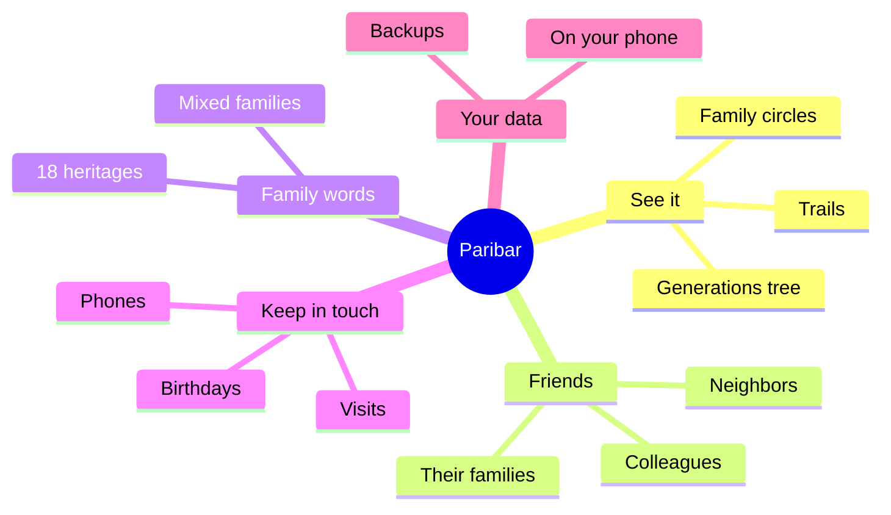
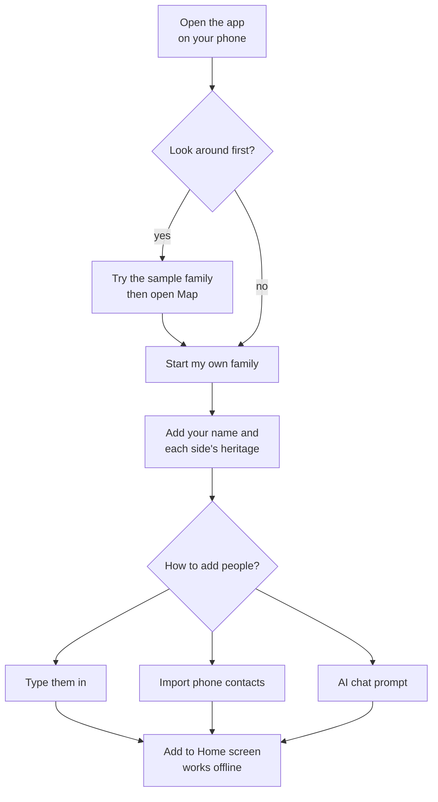
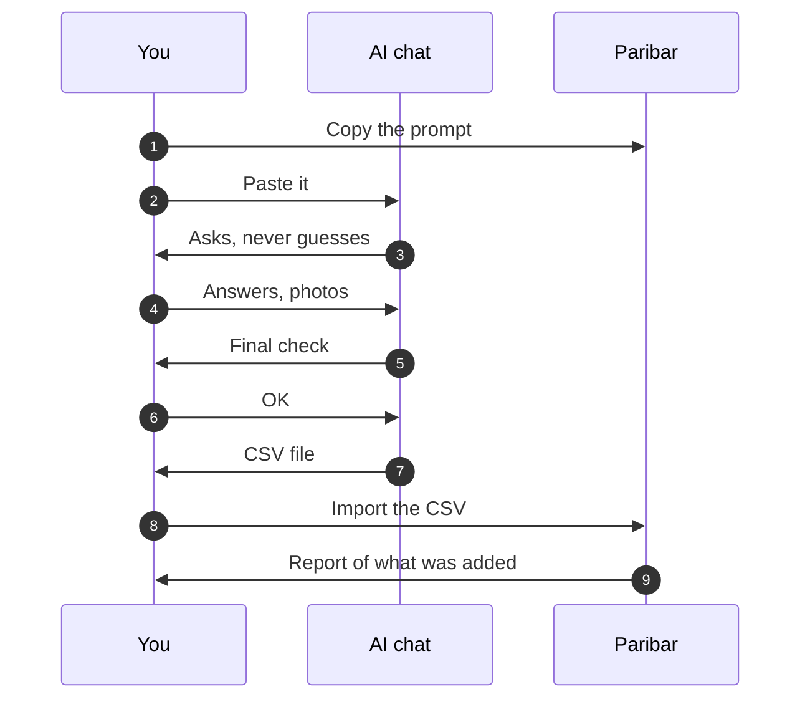
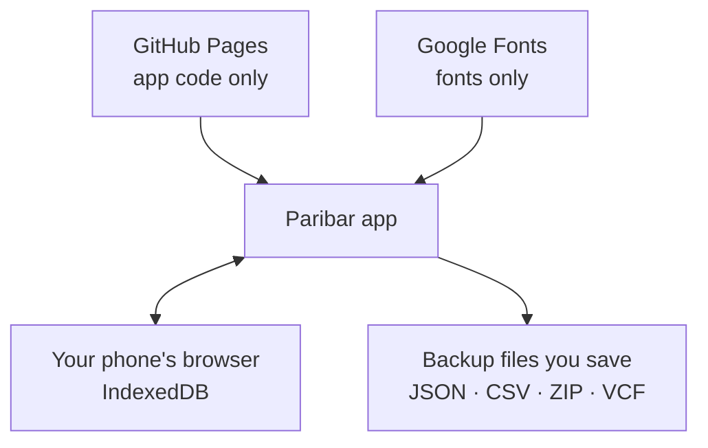

# Paribar · পরিবার

See how everyone is connected: your whole family, and the friends who are family too, on a **Generations tree** and in **Family circles** around you. Free, offline, and in your family's own words (Mashi, 姨媽, Tía, Bua …), across 18 heritages.

- **Use it:** [akaseahawk.github.io/paribar-family-tree](https://akaseahawk.github.io/paribar-family-tree/)
- **Open the app directly:** [/app/](https://akaseahawk.github.io/paribar-family-tree/app/)
- **Single-file version:** [/download/paribar-standalone.html](https://akaseahawk.github.io/paribar-family-tree/download/paribar-standalone.html)

Every name in this repo is made up. Real family data never goes in this repo.

## Why I built this

I went back to India after 20 years and knew exactly two relatives by name and phone number. That was it. I built Paribar so that the next time I visit, years from now, I can reach out to everyone directly and keep in touch.

- On that trip we drew the family out on paper, took one photo, and had the data. We imported phone contacts and took pictures of everyone, great-grandparents included.
- When I showed them the family tree and the circles, they loved it.
- The best part was the conversations: stories that never come up otherwise, like the wild thing a distant uncle once did. He's on the map now.
- Family history still lives in memories, on paper, or in a photo on the wall. Paribar makes it digital, so you can share it with your kids and keep it, in theory, forever.

With the holidays here and families getting together, I hope you get to have these conversations too.

## See it

| Family circles | Generations tree |
|---|---|
|  |  |
| You're in the middle; each ring is one more step away. | One column per generation, couples side by side, friends in their own band. |

**Friends can be family too.** Add the neighbor who's practically an uncle, Mom's best friend the kids call Auntie, a colleague or a classmate. They appear on both maps, linked through whoever they know, and their families can join too.

## At a glance

## Start in four steps

## Fill it in with an AI chat

The app has a ready-made prompt (Settings › Fill it in with an AI chat). It already includes the data dictionary, so the AI knows exactly which columns to produce.

Rules the prompt gives the AI:
- **Ask, don't assume.** No guessed names, genders, sides or ages.
- **Placeholders only to connect people,** for example the unnamed mother between you and a cousin, named like `Unknown (Bubai's mother)`.
- **Empty means unknown.** No "N/A" or "?".

The full prompt and data dictionary are in [docs/ai-prompt.md](docs/ai-prompt.md).

## Where your data lives

No account and no server storage. Clearing your browser data erases it, so back up now and then. Voice typing uses the browser's speech service, and what you tell an AI chat goes to that company. Details: [docs/privacy.md](docs/privacy.md).

## Docs

| Doc | What's in it |
|---|---|
| [How it works](docs/how-it-works.md) | Modules, how a family word is chosen, import and export |
| [Data model](docs/data-model.md) | People, links, visits, CSV columns |
| [AI prompt](docs/ai-prompt.md) | The prompt, tips and data dictionary |
| [Privacy](docs/privacy.md) | What stays on your phone, what doesn't |
| [Developing](docs/developing.md) | Run it, test it, release it |

## Run it yourself

- **Any static host:** serve the repo root over https. Offline mode and voice need https, or localhost.
- **Local:** `npm start` → http://localhost:3000
- **Single file:** `python3 build-standalone.py` → `dist/paribar-standalone.html`
- **GitHub Pages:** [.github/workflows/pages.yml](.github/workflows/pages.yml) builds the landing page, `/app/` and `/download/` on every push to `main`.

## Author

Made by [akaseahawk](https://github.com/akaseahawk).
