# Paribar · পরিবার

See how everyone is connected: your whole family, and the friends who are family too, on a **Generations tree** and in **Family circles** around you. Free, offline, and in your family's own words (Mashi, 姨媽, Tía, Bua …), across 20+ heritages. Don't see yours? [Let me know](https://github.com/akaseahawk/paribar-family-tree/issues/new?title=Heritage%20request:%20) and I'll add it.

- **Use it:** [akaseahawk.github.io/paribar-family-tree](https://akaseahawk.github.io/paribar-family-tree/)
- **Open the app directly:** [/app/](https://akaseahawk.github.io/paribar-family-tree/app/)
- **Single-file version:** [/download/paribar-standalone.html](https://akaseahawk.github.io/paribar-family-tree/download/paribar-standalone.html)

Every name in this repo is made up. Real family data never goes in this repo.

## Why I built this

I went back to India after 20 years knowing only two relatives, both very elderly, and just their names and phone numbers. So I built Paribar (family in Bengali): it shows how everyone is connected, tells me what to call each person, and keeps their details in one place, so next time I can reach out to everyone directly.

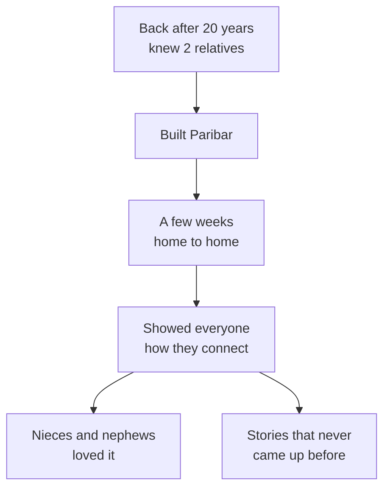

- For a few weeks I went home to home, across the family and close friends.
- At every stop I showed everyone how they were all connected. We took everyone's picture and snapped old photos of ancestors, so every face is on the map. My little nieces and nephews loved it.
- The conversations were the best part: stories that never come up otherwise, like the wild thing a distant uncle once did. He's on the map now.
- Family history still lives in memories, on paper, or in a photo on the wall. Paribar makes it digital, so you can share it with your kids and keep it, in theory, forever.

### The right word for everyone

In many families there's no plain "aunt" or "uncle". The word says whose side someone is on and whether they're older or younger, and using the right one is how you show respect. Paribar works it out automatically from how people are linked and who's older.

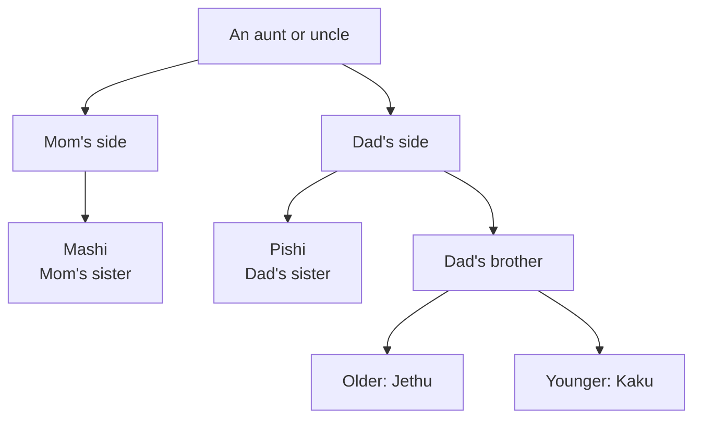

- Hindi does the same with Tauji and Chacha, Punjabi with Taya and Chacha, Korean with 큰아버지 and 작은아버지.
- A birth year, or even "the 1960s", is enough for Paribar to know who's older. It can also say each word out loud.

### 20+ heritages, one sample each

What Paribar calls four of the sample family's relatives in every heritage it knows. Some use one word where others use four; Paribar uses whichever your family does. Don't see yours? [Ask me](https://github.com/akaseahawk/paribar-family-tree/issues/new?title=Heritage%20request:%20).

| Heritage | Mom's sister | Dad's sister | Dad's younger brother | Mom's mom |
|---|---|---|---|---|
| Bengali | মাসি Mashi | পিসি Pishi | কাকু Kaku | দিদিমা Didima |
| Hindi / North Indian | मौसी Mausi | बुआ Bua | चाचा Chacha | नानी Nani |
| Punjabi | ਮਾਸੀ Masi | ਭੂਆ Bhua | ਚਾਚਾ Chacha | ਨਾਨੀ Nani |
| Gujarati | માસી Masi | ફોઈ Foi | કાકા Kaka | નાની Nani |
| Cantonese | 姨媽 Ji Maa | 姑媽 Gu Maa | 叔叔 Suk Suk | 婆婆 Po Po |
| Mandarin | 姨妈 Yímā | 姑姑 Gūgu | 叔叔 Shūshu | 外婆 Wàipó |
| Japanese | 伯母さん Obasan | 伯母さん Obasan | 叔父さん Ojisan | おばあさん Obāsan |
| Korean | 이모 Imo | 고모 Gomo | 작은아버지 Jageunabeoji | 외할머니 Oehalmeoni |
| Vietnamese | Bác | Bác | Chú | Bà ngoại |
| Arabic | خالتو Khalto | عمتو ʿAmmto | عمو ʿAmmo | تيتا Teta |
| Ghanaian (Akan: Twi, Asante, Fante) | Maame panin | Sewaa | Papa kumaa | Nana baa |
| Nigerian (Yoruba) | Ẹ̀gbọ́n ìyá | Ẹ̀gbọ́n bàbá | Àbúrò bàbá | Ìyá àgbà |
| Spanish (Mexico & Latin America) | Tía | Tía | Tío | Abuela |
| Spanish (Puerto Rico & Dominican Rep.) | Titi | Titi | Tío | Abuela |
| Spanish (Argentina & Uruguay) | Tía | Tía | Tío | Nona |
| Haitian Creole | Matant | Matant | Tonton | Grann |
| Jamaican Patois | Auntie | Auntie | Uncle | Granny |
| English (American) | Aunt | Aunt | Uncle | Grandma |
| French | Tante | Tante | Oncle | Grand-mère |
| German | Tante | Tante | Onkel | Oma |
| Irish (Gaelic) | Aintín | Aintín | Uncail | Mamó |
| Italian | Zia | Zia | Zio | Nonna |
| Romanian | Mătușă | Mătușă | Unchi | Bunică |
| Swedish | Moster | Faster | Farbror | Mormor |

### How the family got in

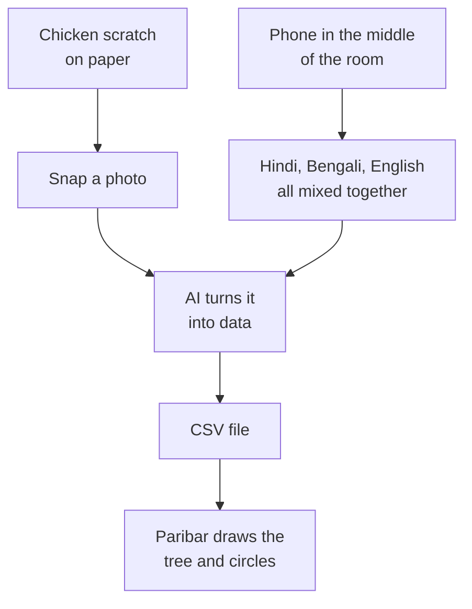

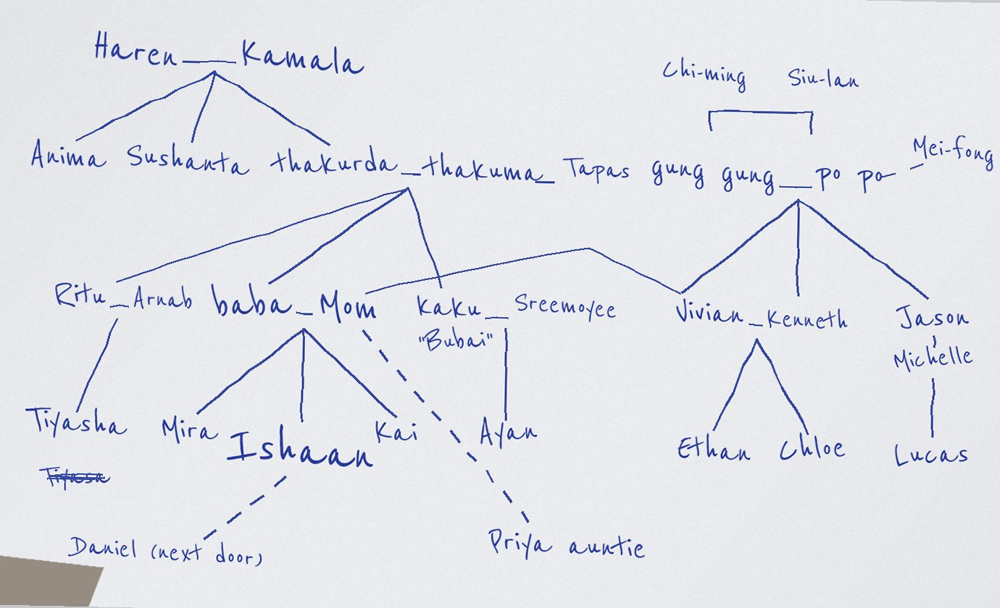

- We drew the family out on paper and snapped a photo, then put a phone in the middle of the room and just talked.
- An AI read the drawing and the conversation and turned them into data. I imported that, and Paribar built the tree and the circles. The AI only saves the typing; you can always add people by hand.
- The family words fill in a lot on their own: a Mashi is your mother's sister, a Jethu your father's older brother.

With the holidays here and families getting together, I hope you get to have these conversations too.

## See it

| Family circles | Generations tree |
|---|---|
|  | 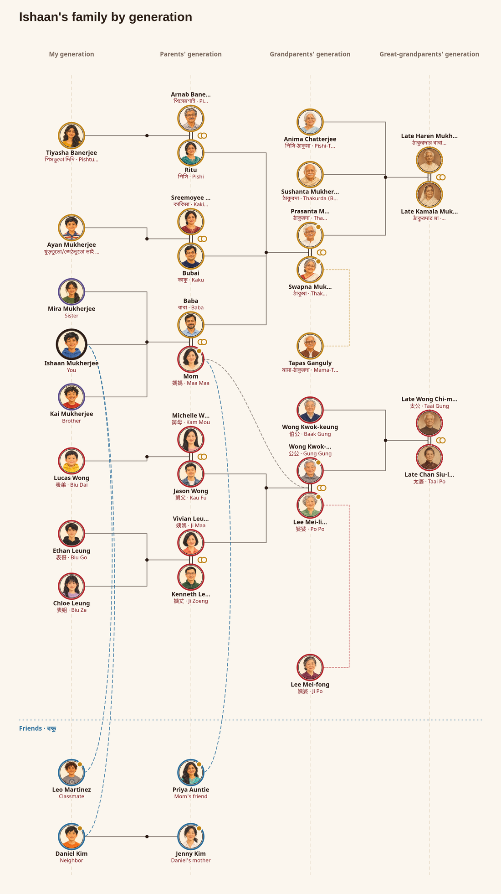 |
| You're in the middle; each ring is one more step away. | One column per generation, couples side by side, friends in their own band. |

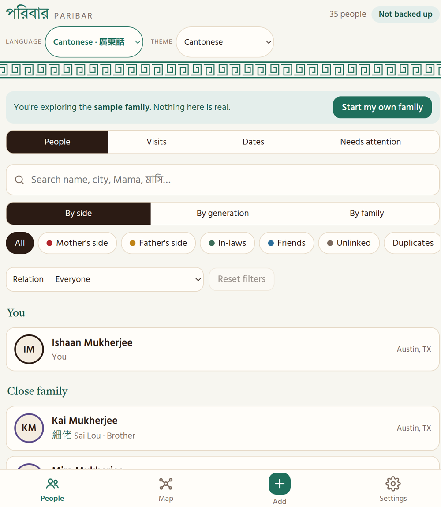 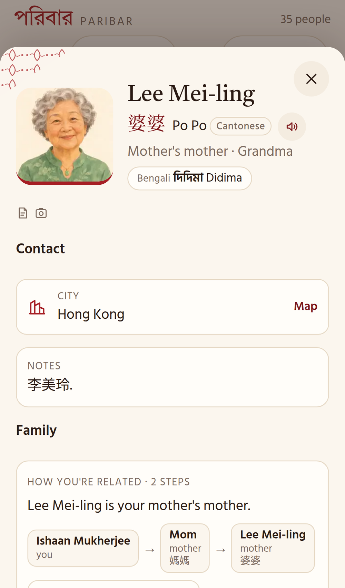

**Faces on the map.** Add a photo and it fills that person's circle on both maps, so kids can put faces to names. Old ancestor photos work too: snap the one on the wall. The sample family's faces are illustrations of made-up people.

**Friends can be family too.** Add the neighbor who's practically an uncle, Mom's best friend the kids call Auntie, a colleague or a classmate. They appear on both maps, linked through whoever they know, and their families can join too.

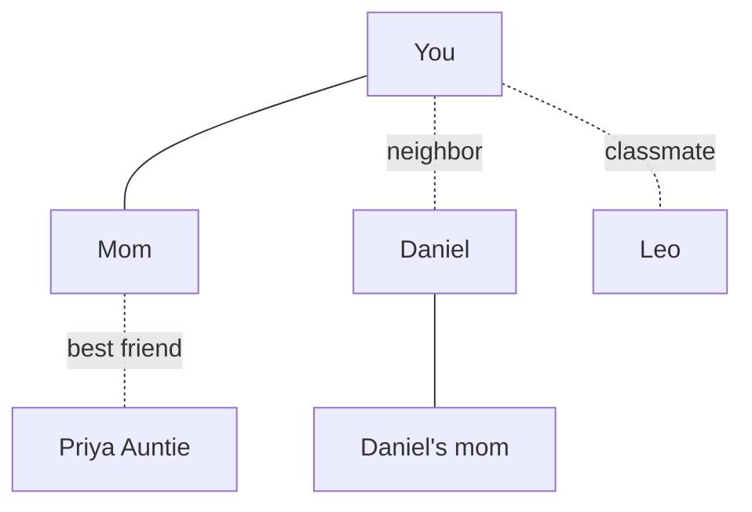

## At a glance

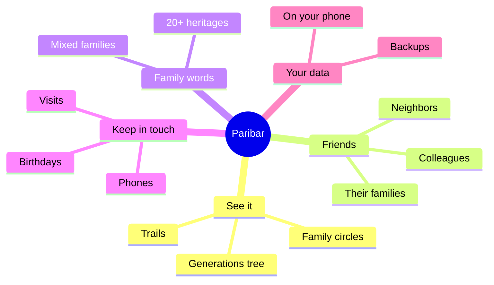

## Start in four steps

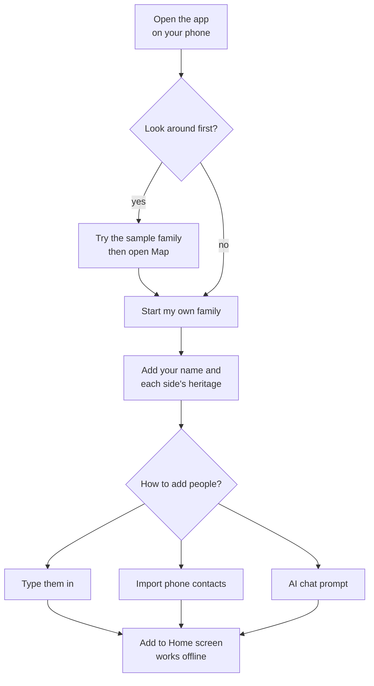

## Stay in touch

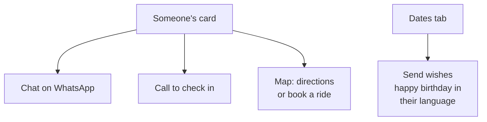

Everyone's phone, WhatsApp, address, birthday and visits live in one place, and one tap texts, calls or opens the map.

## Fill it in with an AI chat (optional)

Typing people in by hand works fine. The AI is a shortcut that turns drawings and conversations into the data file Paribar imports. Paribar does the rest.

The app has a ready-made prompt (Settings › Fill it in with an AI chat). It already includes the data dictionary, so the AI knows exactly which columns to produce.

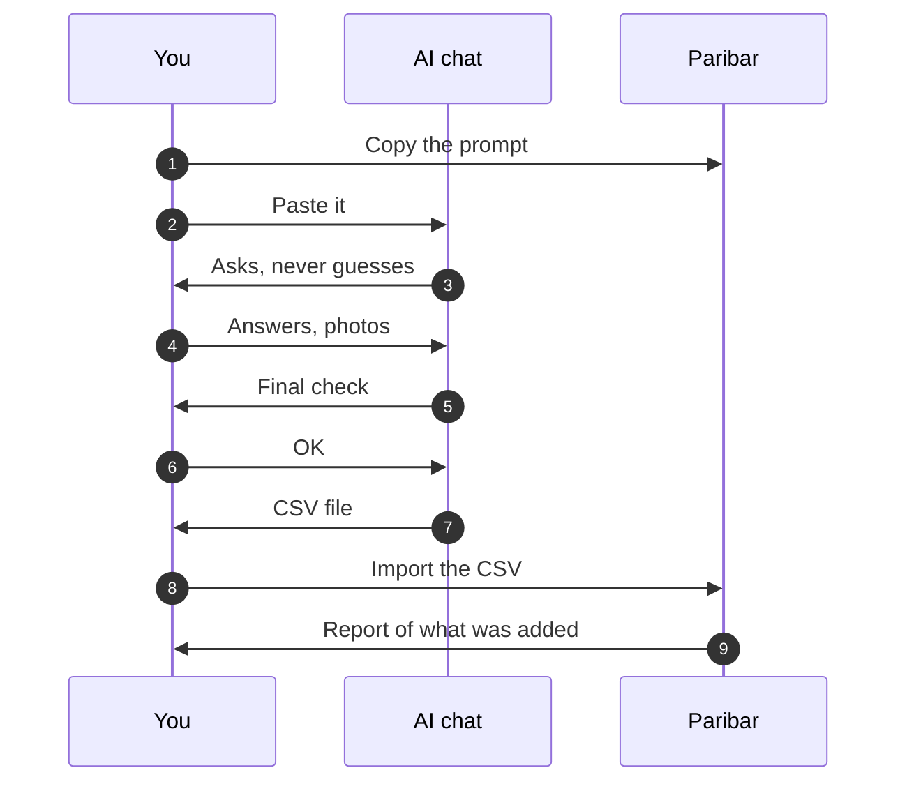

What the AI does for you:
- **Reads a photo of a hand-drawn tree,** even chicken scratch, and turns it into the table.
- **Transcribes a room full of people** talking in any mix of languages.
- **Fills in what family words imply** (Mashi is mother's sister) and asks about the rest.

> **Hot tip: make it a show.** Download the spreadsheet from Paribar (Settings) and give it, with a few family photos, to an AI that makes pictures or video. Ask for a family tree picture or short video in the style of your favorite show, movie or book. Kids love it. Photos you upload go to that company.

Rules the prompt gives the AI:
- **Ask, don't assume.** No guessed names, genders, sides or ages.
- **Placeholders only to connect people,** for example the unnamed mother between you and a cousin, named like `Unknown (Bubai's mother)`.
- **Empty means unknown.** No "N/A" or "?".

The full prompt and data dictionary are in [docs/ai-prompt.md](docs/ai-prompt.md).

## Where your data lives

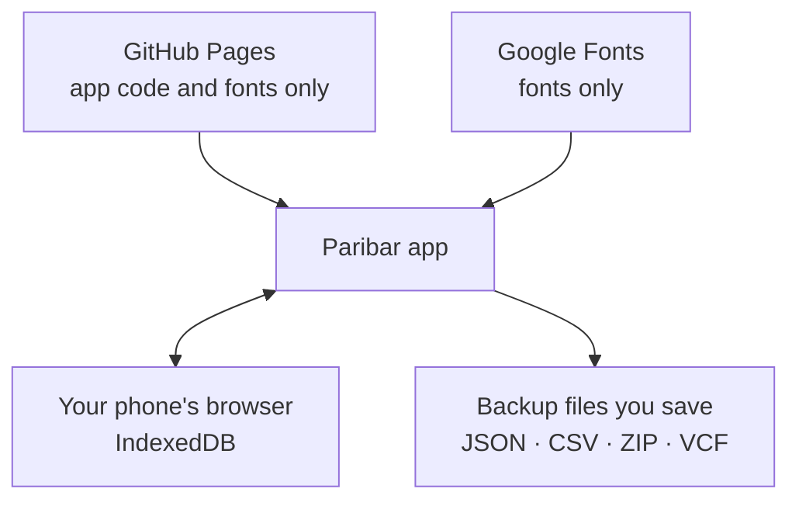

No account, no server storage, no analytics, and no third-party requests: a Content-Security-Policy stops the page from sending data to any other site. Clearing your browser data erases it, so back up now and then. Voice typing uses the browser's speech service, and what you tell an AI chat goes to that company. Details: [docs/privacy.md](docs/privacy.md).

## Docs

| Doc | What's in it |
|---|---|
| [How it works](docs/how-it-works.md) | Modules, how a family word is chosen, import and export |
| [Data model](docs/data-model.md) | People, links, visits, CSV columns |
| [AI prompt](docs/ai-prompt.md) | The prompt, tips and data dictionary |
| [Privacy](docs/privacy.md) | What stays on your phone, what doesn't |
| [Security](SECURITY.md) | How it's protected, its limits, how to report a problem |
| [Developing](docs/developing.md) | Run it, test it, release it |

## Run it yourself

- **Any static host:** serve the repo root over https. Offline mode and voice need https, or localhost.
- **Local:** `npm start` → http://localhost:3000
- **Single file:** `python3 build-standalone.py` → `dist/paribar-standalone.html`
- **GitHub Pages:** [.github/workflows/pages.yml](.github/workflows/pages.yml) builds the landing page, `/app/` and `/download/` on every push to `main`.

## Author

Made by [Akash](https://github.com/akaseahawk).

## License

[PolyForm Noncommercial 1.0.0](LICENSE.md). Free for personal, family, research, school, nonprofit and other noncommercial use. Commercial use needs separate permission, so [ask me](https://github.com/akaseahawk). Bundled libraries and fonts keep their own licenses: see [THIRD-PARTY-NOTICES.md](THIRD-PARTY-NOTICES.md).

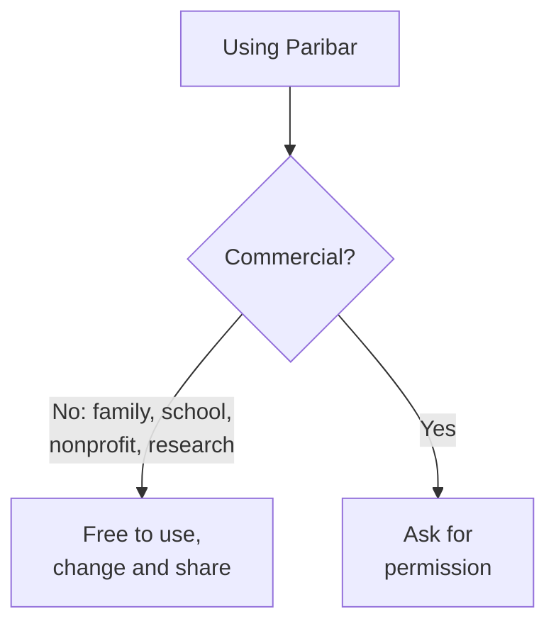

