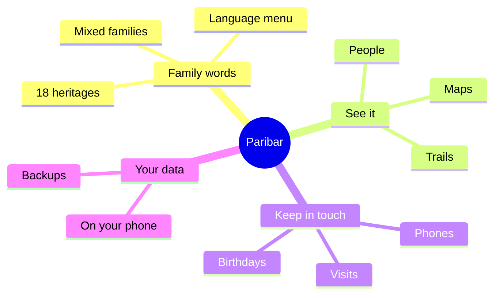
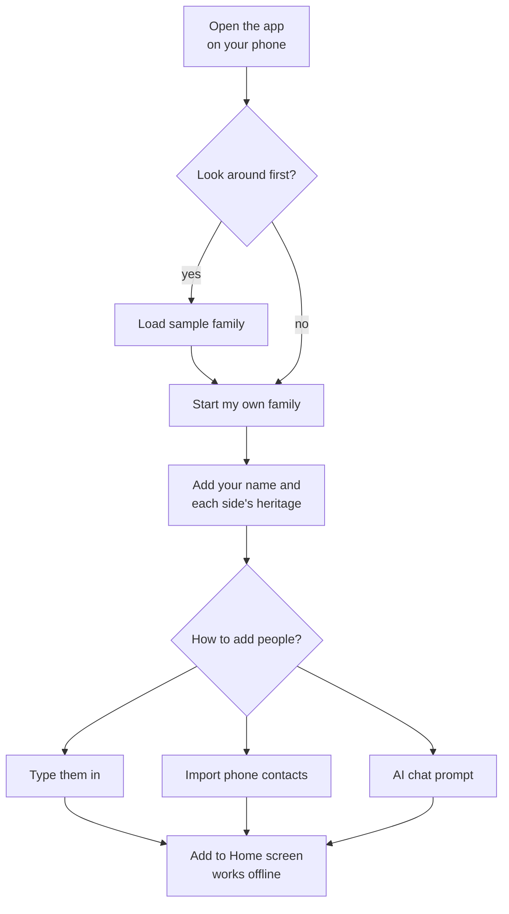
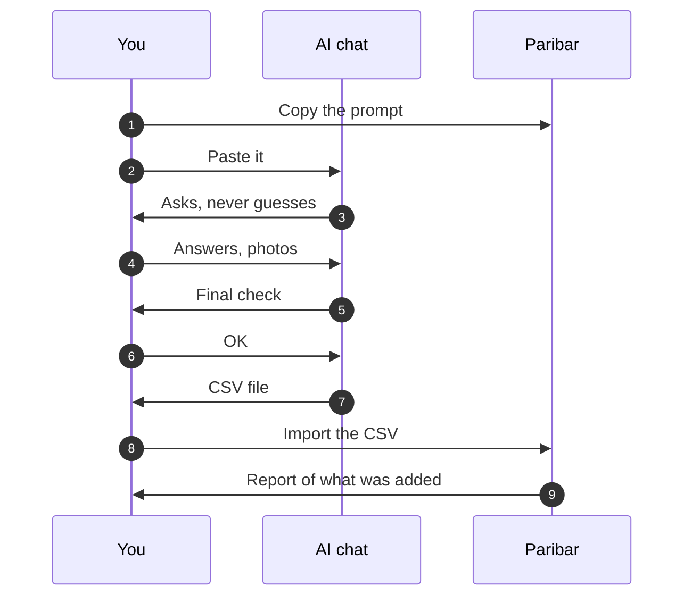
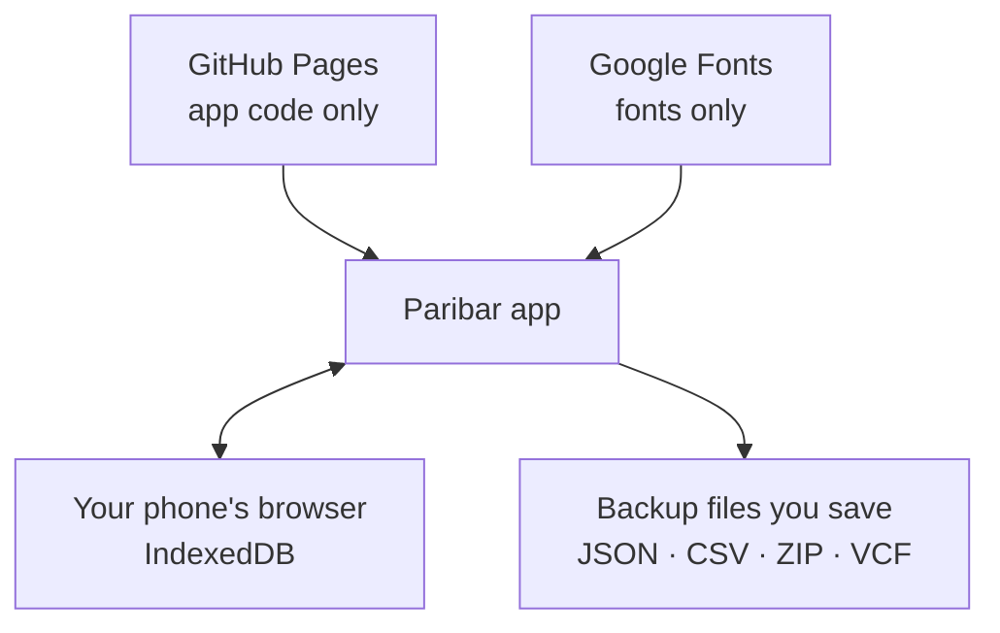

# Paribar · পরিবার

A free family tree and contact book that knows what you call everyone, in your family's own words.

- **Use it:** [akaseahawk.github.io/paribar-family-tree](https://akaseahawk.github.io/paribar-family-tree/)
- **Open the app directly:** [/app/](https://akaseahawk.github.io/paribar-family-tree/app/)
- **Single-file version:** [/download/paribar-standalone.html](https://akaseahawk.github.io/paribar-family-tree/download/paribar-standalone.html)

Every name in this repo is made up. Real family data never goes in this repo.

## At a glance

## Start in four steps

## Fill it in with an AI chat

The app has a ready-made prompt (Settings › Fill it in with an AI chat). It already includes the data dictionary, so the AI knows exactly which columns to produce.

Rules the prompt gives the AI:
- **Ask, don't assume.** No guessed names, genders, sides or ages.
- **Placeholders only to connect people,** for example the unnamed mother between you and a cousin, named like `Unknown (Bubai's mother)`.
- **Empty means unknown.** No "N/A" or "?".

The full prompt and data dictionary are in [docs/ai-prompt.md](docs/ai-prompt.md).

## Where your data lives

No account and no server storage. Clearing your browser data erases it, so back up now and then. Voice typing uses the browser's speech service, and what you tell an AI chat goes to that company. Details: [docs/privacy.md](docs/privacy.md).

## Docs

| Doc | What's in it |
|---|---|
| [How it works](docs/how-it-works.md) | Modules, how a family word is chosen, import and export |
| [Data model](docs/data-model.md) | People, links, visits, CSV columns |
| [AI prompt](docs/ai-prompt.md) | The prompt, tips and data dictionary |
| [Privacy](docs/privacy.md) | What stays on your phone, what doesn't |
| [Developing](docs/developing.md) | Run it, test it, release it |

## Run it yourself

- **Any static host:** serve the repo root over https. Offline mode and voice need https, or localhost.
- **Local:** `npm start` → http://localhost:3000
- **Single file:** `python3 build-standalone.py` → `dist/paribar-standalone.html`
- **GitHub Pages:** [.github/workflows/pages.yml](.github/workflows/pages.yml) builds the landing page, `/app/` and `/download/` on every push to `main`.

## Author

Made by [akaseahawk](https://github.com/akaseahawk).
