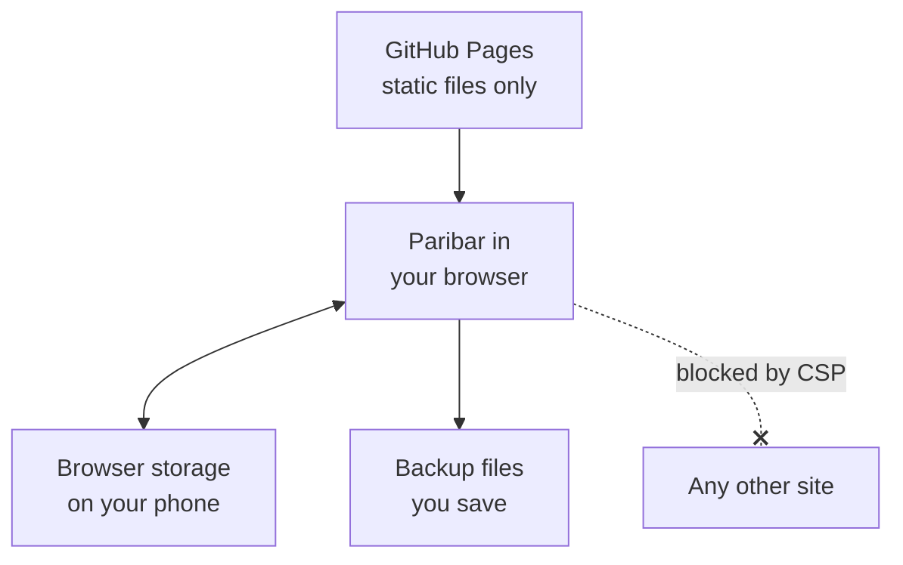

# Security

Paribar holds people's family details: names, phones, addresses, photos and birthdays. Please report anything that could expose them.

## Reporting a problem
- Use **[Report a vulnerability](https://github.com/akaseahawk/paribar-family-tree/security/advisories/new)** (private to the maintainer).
- Please don't open a public issue for security problems.
- I'll reply within a few days. This is a one-person side project, so there's no bounty, but you'll get credit if you'd like.

## How Paribar is built

- **No server, no account, no analytics.** GitHub Pages serves static files. There is no backend to send data to.
- **Content-Security-Policy** on every page: the app may only load its own files (`default-src 'none'`, `script-src 'self'`, `connect-src 'self'`). Fonts are self-hosted, so loading Paribar makes no third-party requests. The single-file download uses an even stricter policy (`connect-src data: blob:` only).
- **`Referrer-Policy: no-referrer`**, so tapping Map or WhatsApp doesn't tell those sites where you came from.
- **No third-party scripts.** d3 and fflate are checked into `vendor/`, not loaded from a CDN.
- **Imports are treated as untrusted:** IDs, photos (data: images only) and visits are cleaned before saving, and all text is HTML-escaped before display. An XSS regression test runs on every release.
- **Photos** are re-encoded through a canvas, which drops EXIF data such as GPS location.
- **Deploys** run from a pinned, least-privilege GitHub Actions workflow. Force pushes and branch deletion on `main` are blocked.

## What Paribar does not protect against
Being honest about the limits:
- **Someone with your unlocked phone or browser.** Data in browser storage isn't encrypted by Paribar, and there's no app passcode. Your phone's own lock and encryption are the protection.
- **Malicious browser extensions** with access to all sites can read any page's data, including this one.
- **Backup files** (.json, .csv, .zip) are not encrypted. Treat them like a contact list: be careful where you send them.
- **AI chats and voice typing.** What you tell or show an AI chat goes to that company. In Chrome, voice typing sends audio to Google to turn it into text.
- **The code you load.** Like any website, you trust that the code served is the code in this repo. Changes go through this public repo, so they can be reviewed. The single-file download never updates itself, so it doesn't change under you, but it doesn't get fixes either.
- **The shared github.io address.** Browsers treat everything under akaseahawk.github.io as one site. No other project there uses Pages today; a custom domain would remove this entirely.
- **Leaving the page.** A content policy can't stop a page from navigating away, so the CSP limits background requests, not links you tap.
