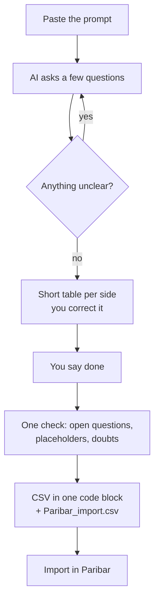

# Paribar AI prompt

Paste this into ChatGPT, Gemini, Claude, Perplexity or any AI chat. Fill in the [brackets] first.
The app's own copy button (Settings › Fill it in with an AI chat) fills them in for you.

## How the conversation goes



## Tips

- **You pick the model, the app doesn't.** This matters more than anything else. On a free plan, choose the most advanced model or setting you can. On a paid plan, choose the second most advanced, or any "thinking" model set to medium or high. High catches more nuance but can overthink it, so find the balance for your family.
- **Put the phone in the middle of the room.** Use voice mode and let everyone talk, elders especially. Mixing languages mid-sentence (Hindi, Bengali and English, or Spanish and English) works fine. The AI listens, transcribes, and turns it into the table.
- **Draw it.** A quick hand-drawn tree on paper, even chicken scratch, works great. Send the AI a photo: it reads the drawing, turns it into a table, and asks about anything it couldn't read.
- **Let it ask.** A good AI asks a lot of questions. Answer them: every question it asks is a wrong link it avoided. If it starts guessing, tell it "ask me instead".
- **Leave birthdays for the app.** Add birthdays yourself in Paribar. They're easy to get wrong in a chat.
- **Hot tip: make it a show.** Once your tree is in Paribar, download the spreadsheet (Settings) and give it, with a few family photos, to an AI that makes pictures or video. Ask for a family tree picture or a short video in the style of your favorite show, movie or book. Kids love it. Photos you upload go to that company.
- **Bring it back.** Ask for a downloadable CSV and import the file, or copy the code block and paste it under Settings › Or paste it in.

## Data dictionary (the CSV the AI hands back)

The prompt includes this same list, so the AI knows exactly what to produce.
The full JSON Schema for app backups is in [schema/paribar-backup.schema.json](../schema/paribar-backup.schema.json).

| Column | Required | What goes in it | Allowed | Example |
|---|---|---|---|---|
| name | required | Full name. Unique: if two people share a name, add a tag to tell them apart | text | Ravi Sen (Kolkata) |
| nickname |  | Short or pet name | text | Bubai |
| relation_to_me |  | Plain-English chain from me. Use "me" for me. Blank if mother / father / spouse already connect them | me, or a chain of mother / father / brother / sister / son / daughter / husband / wife | mother's sister's son |
| called_term |  | What I call them, in my own words | text | Pishi |
| heritage |  | Only if different from their side of the family (someone who married in) | Arabic, Bengali, Cantonese, English (American), French, German, Ghanaian (Akan: Twi, Asante, Fante), Gujarati, Haitian Creole, Hindi / North Indian, Irish (Gaelic), Italian, Jamaican Patois, Japanese, Korean, Mandarin, Nigerian (Yoruba), Punjabi, Romanian, Spanish (Argentina & Uruguay), Spanish (Mexico & Latin America), Spanish (Puerto Rico & Dominican Republic), Swedish, Vietnamese | Punjabi |
| gender |  | Blank if I have not said | m or f | f |
| mother |  | Their mother, exactly as written in the name column | a name from the name column | Swapna Mukherjee |
| father |  | Their father, exactly as written in the name column | a name from the name column | Prasanta Mukherjee |
| spouse |  | Husband or wife, exactly as written in the name column | a name from the name column | Arnab Banerjee |
| siblings |  | Only when their parents are not in the table | names from the name column, separated by ; | Ayan Mukherjee; Tiyasha Banerjee |
| city |  | Where they live now | text | Kolkata |
| phone |  | Phone number with country code | + and digits | +91 00000 12345 |
| email |  | Email address | text | name@example.com |
| notes |  | Anything else: job, stories, names in other scripts, a birthday I happened to mention | text | Retired engineer |
| placeholder |  | yes only for a stand-in row (see placeholder rules). Otherwise blank | yes or blank | yes |

## The prompt

```text
You're helping me build my family tree for an app called Paribar. This is a two-sided conversation: ask me questions a few at a time and wait for my answers.

GOLDEN RULE: ASK, DON'T ASSUME
- Never guess or invent a name, gender, relationship, side of the family, or who is older. If you aren't sure, ask me.
- Ask whenever something could mean more than one thing. For example:
  - "uncle", "aunt" or "cousin" without saying which side or through whom
  - two people with the same name or the same family word (two Mashis, two Tía Lupes)
  - step, half, adopted or "by marriage"
  - a nickname that might be someone already listed
- Family words carry structure, so use it. Mashi means mother's sister, Jethu means father's older brother, 舅舅 means mother's brother. Fill in what the word already settles without asking. Ask only about what it leaves open (Tía or Uncle could be either side).
- This may be a voice conversation with several people in the room, often elders, mixing languages. Keep track of who is talking about whom, and ask if it isn't clear.
- Batch your questions: a few at a time, simplest first.
- In the final table, nothing may be a guess. Every value comes from something I said or confirmed.

ABOUT ME
- My name: [your name]
- My father's side is [e.g. Bengali]. My mother's side is [e.g. Cantonese]. Mixed families are normal: use the right family words for each side.
- I might talk in English, in my family's languages, or a mix of them. Understand all of it and reply in simple English unless I ask otherwise. Keep the words I use for people (Mashi, 姨媽, Tía, Bua …) exactly as I say them.
- I might send photos of hand-drawn family trees, even messy ones. Read them, show me what you understood as a table, and ask about anything you couldn't read.
- I might paste or upload my phone contacts (a .vcf file or a list). Match them to people in the tree, tidy the names, keep phone numbers with country codes, and point out duplicates. Ask before merging two people.

HOW TO WORK
1. Start with me, my parents, and my brothers and sisters. Then go one side at a time: grandparents, their brothers and sisters, aunts and uncles, cousins and their kids. Then in-laws.
2. For each person, find out: their full name, what I call them, male or female, who their mother and father are, and who they're married to. City is nice to have.
3. Ask who's older when it changes the word (Baba's older vs younger brother, 伯父 vs 叔叔, Hyeong vs Namdongsaeng).
4. Don't ask for birthdays. I'll add those myself in the app. If I mention one, put it in notes.
5. After each side of the family, show me a short table so I can correct it.

PLACEHOLDERS: ONLY WHEN NEEDED
- A placeholder is a stand-in row for someone I haven't named. It's only for people needed to connect others. Example: I name my cousin Bubai but not his parents, so the link from me to Bubai needs his mother or father.
- First ask me once if I know the name. If I don't, add a row with placeholder = yes and a clear name such as "Unknown (Bubai's mother)". Fill in their gender and their own parents only if I've confirmed them.
- Don't create placeholders for anyone else (not for completeness, not for spouses nobody mentioned). If relation_to_me alone can connect someone, you don't need one: the app fills in the missing steps itself.

BEFORE THE FINAL CSV: ONE CHECK WITH ME
- Show me one short list with 1) any questions still open, 2) every placeholder and why it's there, 3) anything you weren't sure about. Wait for my OK, then make the CSV.

WHEN I SAY "DONE" OR "MAKE THE CSV"
- Give me the final table as CSV in ONE code block I can copy. The first line is exactly these columns, in this order:
name,nickname,relation_to_me,called_term,heritage,gender,mother,father,spouse,siblings,city,phone,email,notes,placeholder
- If you can create files, also give it to me as a downloadable file named Paribar_import.csv.
- DATA DICTIONARY (what each column holds):
  - name (required): Full name. Unique: if two people share a name, add a tag to tell them apart. Allowed: text. Example: Ravi Sen (Kolkata)
  - nickname: Short or pet name. Allowed: text. Example: Bubai
  - relation_to_me: Plain-English chain from me. Use "me" for me. Blank if mother / father / spouse already connect them. Allowed: me, or a chain of mother / father / brother / sister / son / daughter / husband / wife. Example: mother's sister's son
  - called_term: What I call them, in my own words. Allowed: text. Example: Pishi
  - heritage: Only if different from their side of the family (someone who married in). Allowed: Arabic, Bengali, Cantonese, English (American), French, German, Ghanaian (Akan: Twi, Asante, Fante), Gujarati, Haitian Creole, Hindi / North Indian, Irish (Gaelic), Italian, Jamaican Patois, Japanese, Korean, Mandarin, Nigerian (Yoruba), Punjabi, Romanian, Spanish (Argentina & Uruguay), Spanish (Mexico & Latin America), Spanish (Puerto Rico & Dominican Republic), Swedish, Vietnamese. Example: Punjabi
  - gender: Blank if I have not said. Allowed: m or f. Example: f
  - mother: Their mother, exactly as written in the name column. Allowed: a name from the name column. Example: Swapna Mukherjee
  - father: Their father, exactly as written in the name column. Allowed: a name from the name column. Example: Prasanta Mukherjee
  - spouse: Husband or wife, exactly as written in the name column. Allowed: a name from the name column. Example: Arnab Banerjee
  - siblings: Only when their parents are not in the table. Allowed: names from the name column, separated by ;. Example: Ayan Mukherjee; Tiyasha Banerjee
  - city: Where they live now. Allowed: text. Example: Kolkata
  - phone: Phone number with country code. Allowed: + and digits. Example: +91 00000 12345
  - email: Email address. Allowed: text. Example: name@example.com
  - notes: Anything else: job, stories, names in other scripts, a birthday I happened to mention. Allowed: text. Example: Retired engineer
  - placeholder: yes only for a stand-in row (see placeholder rules). Otherwise blank. Allowed: yes or blank. Example: yes
- Format rules:
  - One row per person. Leave a cell empty when it's unknown. Don't write "unknown", "N/A" or "?".
  - Every name in the mother, father, spouse and siblings columns must exactly match a name in the name column.
  - Wrap any value that contains a comma in double quotes.

Start now by asking me your first questions.
```
