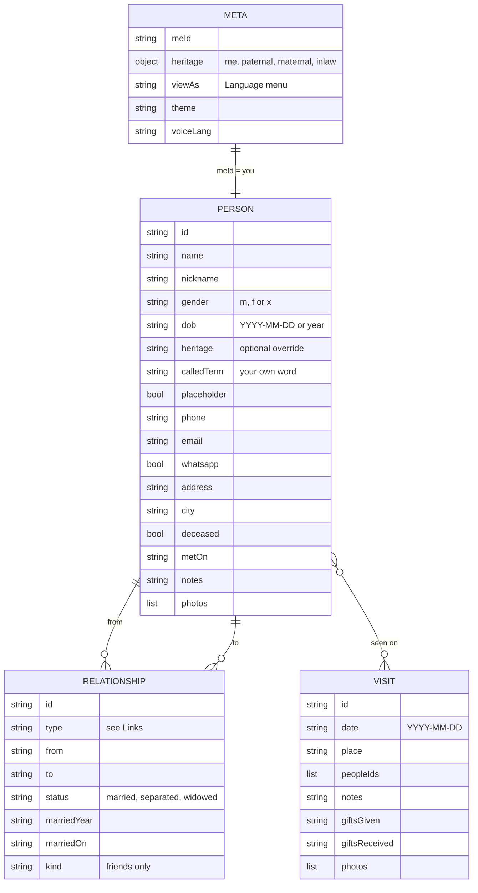

# Data model

Everything is saved in the phone's browser (IndexedDB), in three stores: `people`, `relationships` and `meta`. Visits are saved in `meta` as `visit:<id>` records.

Main fields only. The full list is in [schema/paribar-backup.schema.json](../schema/paribar-backup.schema.json).

## Links

| Type | Means | Notes |
|---|---|---|
| `parent_of` | from = parent, to = child | The backbone of the tree |
| `spouse_of` | either direction | status: married, separated, widowed |
| `sibling_of` | brothers and sisters | Only when their parents aren't in the tree |
| `friend_of` | friends layer | kind: friend, colleague, neighbor, classmate |

Siblings normally come from shared parents. Explicit `sibling_of` links are only for brothers and sisters whose parents aren't in the tree.

## CSV for imports

The AI prompt and the in-app guide use the same data dictionary, kept in `js/aiprompt.js`. See [ai-prompt.md](ai-prompt.md) for the full table.

- Only `name` is required.
- `mother`, `father`, `spouse` and `siblings` must match names in the `name` column exactly. Separate several with `;`.
- `relation_to_me` is a plain-English chain like `mother's sister's son`. The app fills in any missing steps.
- `placeholder` = `yes` marks a stand-in for someone not named yet. The app tags them "add details".
- Dates: MM/DD/YYYY. A year or a decade (1960s) also works.

## Backups

- JSON backups follow [schema/paribar-backup.schema.json](../schema/paribar-backup.schema.json).
- Blank CSV template: [schema/paribar-template.csv](../schema/paribar-template.csv).
- Example backup: [schema/example-import.json](../schema/example-import.json).
