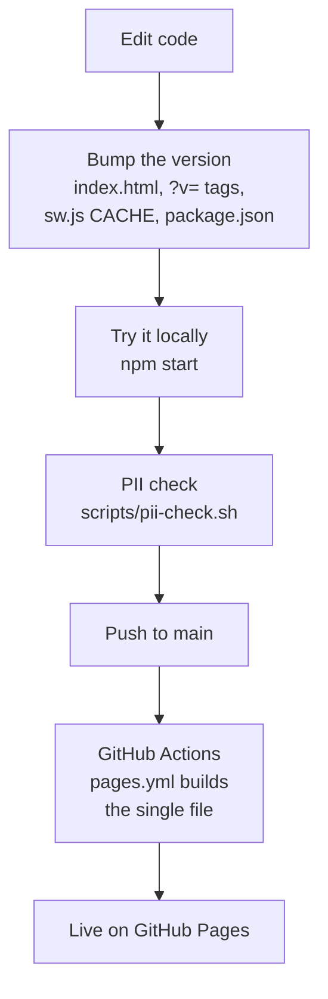
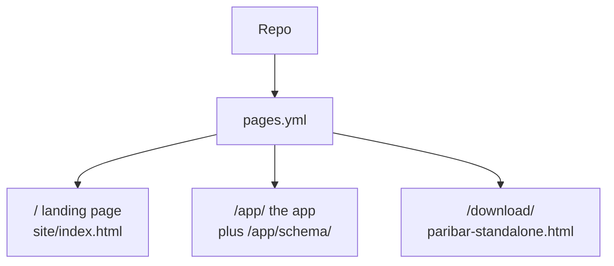

# Developing

## Run it

| Way | Command | Notes |
|---|---|---|
| Local server | `npm start` | http://localhost:3000. Localhost counts as secure, so offline mode and voice work |
| Any static server | `python3 -m http.server 8000` | Same files, no build |
| Single file | `python3 build-standalone.py` | Writes `dist/paribar-standalone.html`. GitHub Actions also builds it for /download/ |
| Railway (optional) | `railway.json` + `server.js` | Tiny static server with a `/healthz` check; it serves only the app files |

## Release flow

## What GitHub Pages serves

## Versioning checklist
- `index.html`: the version label (`Paribar v2.0.14 …`) and every `?v=` tag.
- `sw.js`: `CACHE = 'paribar-v2014'`.
- `package.json`: `"version": "2.0.14"`.
- New files the app needs offline go in the `APP` list in `sw.js`.
- `docs/ai-prompt.md`: regenerate with `node scripts/export-prompt.js` after changing `js/aiprompt.js`.

## Rules for this repo
- **Fake names only.** Use the sample family (`js/demo.js`) or make up new people.
- **Run the PII check** before every push:
  `PARIBAR_DENYLIST=/path/outside/repo/pii-denylist.txt scripts/pii-check.sh`
  If it can't find a deny-list it prints "Nothing to check" and passes, so make sure the path is right. A `pii-allowlist.txt` next to the deny-list can allow entries that are meant to be public, like the author's GitHub handle.
- **Escape what you render.** Use `esc()` for any user text that goes into HTML.
- **Keep it self-contained.** Every page has a Content-Security-Policy `<meta>` tag that only allows the site's own files. Don't add CDNs, web fonts or analytics; put files in `vendor/` or `fonts/` instead. No inline `<script>` or `onclick=` attributes in the app (the CSP blocks them).
- **Never drop data.** The storage format only gains fields; older backups must still import.
