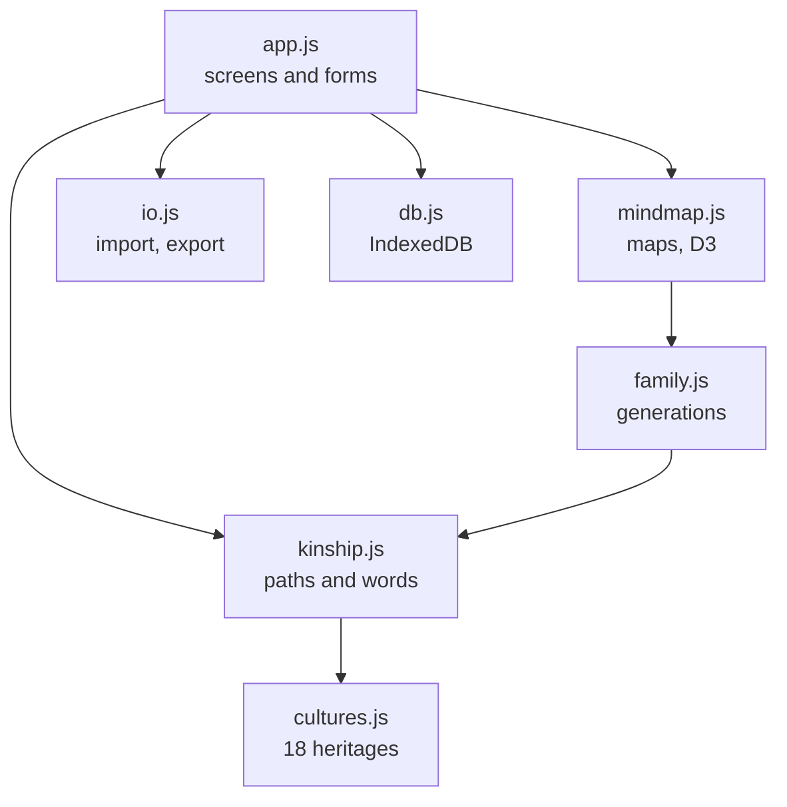
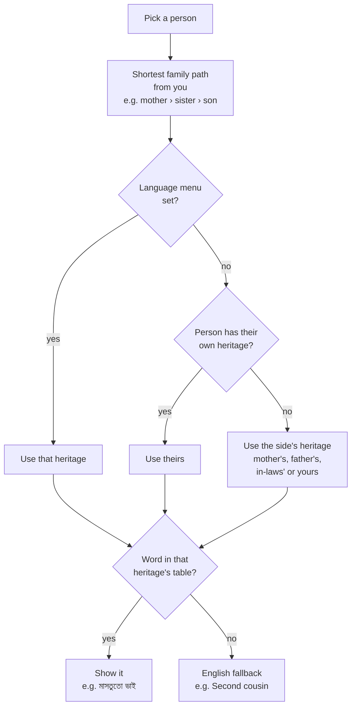
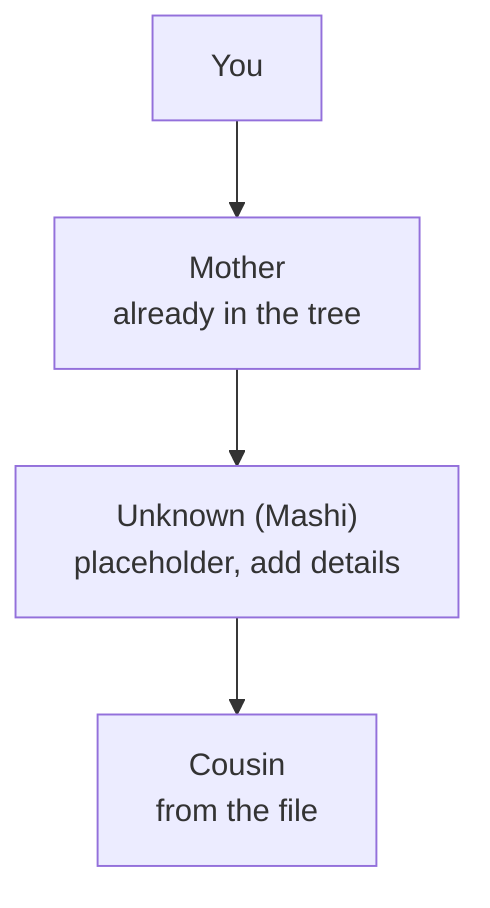
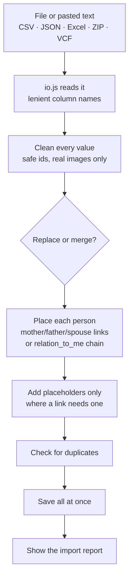
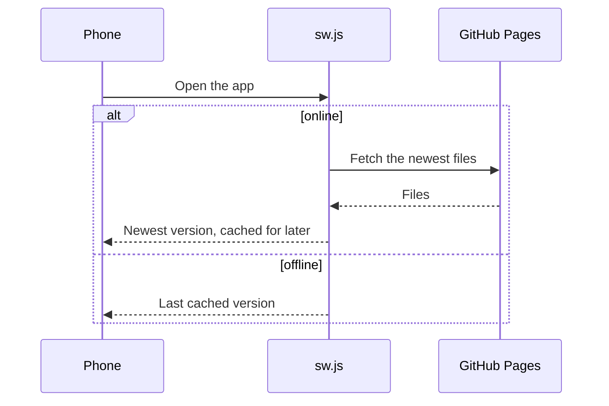

# How it works

Paribar is plain HTML, CSS and JavaScript. No framework, no build step for the app, and no backend.

## The pieces

themes, aiprompt, checks, dupes, visits, dates, speak, treeimage and demo are helpers that app.js calls.

| File | Job |
|---|---|
| `js/app.js` | Screens, forms, placing imported people, export |
| `js/kinship.js` | Finds the path from you to anyone and picks the word for it |
| `js/cultures.js` | Family words for 18 heritages, with an English fallback that handles "second cousin once removed" |
| `js/family.js` | Couples, generations, separation, tree layout |
| `js/mindmap.js` | The Separation map and Generations tree |
| `js/io.js` | Reads CSV, JSON, Excel (.xlsx), ZIP and contacts; writes JSON, CSV, ZIP and .vcf; cleans every imported value |
| `js/demo.js` | The made-up sample family |
| `js/db.js` | Storage in the phone's browser |
| `js/themes.js` | The ten heritage looks |
| `js/aiprompt.js` | The AI prompt and the shared data dictionary |
| `js/checks.js`, `js/dupes.js` | Needs attention, duplicate finder and merge |
| `js/visits.js`, `js/dates.js` | Visit log, birthdays and anniversaries |
| `js/speak.js`, `js/treeimage.js` | Read a word aloud; save the map as a picture |
| `sw.js` | Offline support |

## How a family word is chosen

- Older or younger matters in many languages (Jethu vs Kaku, 伯父 vs 叔叔). Paribar uses birth dates or years when it has them.
- When a gender is unknown, it shows both words, like "Mamato Bhai / Mamato Bon".
- Mixed families: the person card also shows what the other side of the family would call them.
- Your own word for someone (called_term) is shown when the Language menu is off.
- Before the English fallback, each heritage also tries its general rules, and with an unknown gender it tries both forms.
- Friends take their own route ("Colleague", "Priya's husband"). Family links always win over friend links.

## Filling in missing steps

When an import says `relation_to_me = mother's sister's son` but your aunt isn't in the file, Paribar adds a placeholder for her, so the cousin still connects.

## Import

## Updates and offline

Every CSS and JS link in index.html carries `?v=209`, and sw.js uses a matching cache name (`paribar-v209`) and drops older `paribar-v*` caches. So a phone never mixes old and new files after an update. Fonts are cache-first. The Android share target (sharing a contact to Paribar) is also handled in sw.js.
