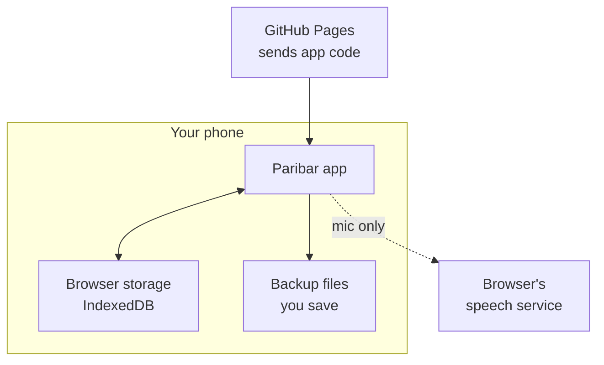

# Privacy

Short version: your family stays on your phone.

## What stays on your phone
- Names, words, links, phones, addresses, photos, birthdays, visits and notes.
- Your settings: heritage, the Language menu, the Theme menu.

## What leaves your phone
- Nothing about your family, unless you share a backup file yourself.
- Loading the page asks GitHub Pages for the app files and Google Fonts for the fonts. Like any website, they see your IP address and browser. They never see family data.
- Tapping WhatsApp, Call or Map opens that app with that one number or address.
- **Voice typing** (the mic buttons) uses your browser's speech service. In Chrome that service runs online, so what you say goes to the browser's maker to be turned into text.
- **AI chats:** anything you tell ChatGPT, Gemini, Claude or Perplexity goes to that company, under their privacy rules. Paribar only gets the CSV you bring back.

## Things to know
- **Back up.** Clearing your browser data, or uninstalling the browser, erases Paribar's data. Settings › Back up saves everything to one file.
- **Protect storage.** Settings › Protect storage from cleanup asks the browser not to clear it on its own.
- **Shared phones.** Anyone who can open your browser can open Paribar.
- **Imported files are checked.** IDs, photos and visits from a file are cleaned before they're saved, to block known code-injection tricks.
- **The github.io address is shared.** Browsers treat everything under akaseahawk.github.io as one site, so other projects on that address could in principle read Paribar's storage. None of them do, and a custom domain would remove this entirely.

## This repo
- Code only. Every name in it is made up.
- Before publishing, `scripts/pii-check.sh` checks the repo's files against a private deny-list that's kept outside the repo. It has to be run by hand; nothing runs it automatically.
